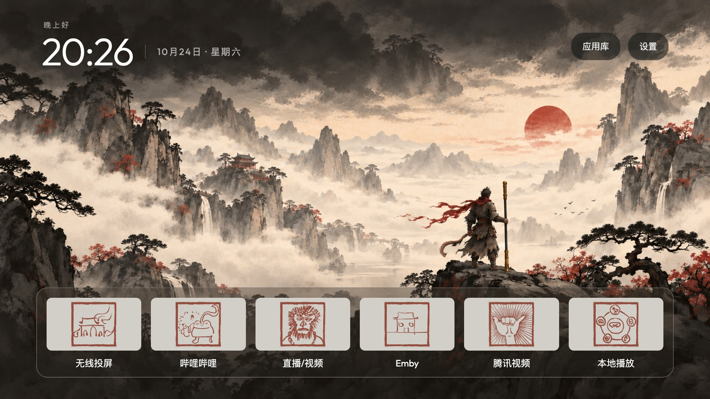

# 黑神话 · 八十一难

个人同人主题，与《黑神话：悟空》及其原作方没有官方关联。

v3 使用暖灰宣纸卡片与朱砂成就印章，呼应壁纸云雾；满版横幅替代旧版青绿底板和硬金角，Dock 托盘采用半透明暖墨褐色。壁纸保留 v2 修正后的单根金箍棒与较少的细碎纹理。主题默认六列、Dock 下方零行，已有手动偏好优先；不更改应用名称、启动动作和顺序。



## 打包与导入

从仓库根目录运行：

```sh
python3 tools/theme_pack.py pack theme-packs/black-myth-wukong artwork/black-myth-wukong/delivery/black-myth-wukong-v3.zip
TV_HOST=TV_IP tools/venv/bin/python tools/theme_pack.py install artwork/black-myth-wukong/delivery/black-myth-wukong-v3.zip --package com.ts.launcher --activate
```

也可在电视首页进入「设置 → 简洁桌面设置 → 主题 → 导入主题 ZIP」，选择生成的文件。需要支持外置 ZIP 主题的 Launcher；已有兼容版本无需更新 APK。

ZIP、生成的 HTML 预览和实机记录不进入版本控制；打包前不需要重新导出美术资源。

## 素材来源

源图来自提供的 `黑神话悟空-Steam成就81难.zip`。81 张 256×256 JPEG 原图保留在 `source/`，其原始 Steam CDN 地址与 SHA-256 见 [成就清单](source/成就清单.csv)。16 个应用的图案映射与原图 SHA-256 见 [icon-map.json](icon-map.json)；其余 65 张不进入主题包。

成就图案的权利归原作权利人所有，不按项目代码许可证另行授权。

壁纸是生成的独立水墨绘画，原稿为 [wallpaper-master-v2.png](wallpaper-master-v2.png)，最终尺寸 1672×941。提示词保留了 [初始构图](wallpaper-prompt.txt)、[纹理调整](wallpaper-edit-v2-prompt.txt) 和 [单棒修正](wallpaper-edit-v2-weapon-fix-prompt.txt)。v3 与 v2 使用相同壁纸。

## 重建卡片与预览

需要 Node.js、npm 和已安装的 Google Chrome。从本目录安装已固定版本的 Playwright，然后运行：

```sh
PLAYWRIGHT_SKIP_BROWSER_DOWNLOAD=1 npm install --no-package-lock
npm run banners
npm run preview
```

[render-banners.cjs](render-banners.cjs) 读取 [banner-design.html](banner-design.html)，将完整 256×256 印章居中放到 512×288 灰底卡面，再叠加整张卡片的轻微暖色罩，导出不透明 JPEG。源文件不改动，不裁掉印章，不添加新纹理；导出的横幅因此不再与源 JPEG 字节相同。圆角和焦点由 Launcher 绘制，图片不烘焙额外边框。

配置采用整张横幅路径，不带 `#rect`，以绕过 Launcher 内置的 fitted 卡片底板。脚本验证原图哈希、图像尺寸与无远程请求，并输出 [banner-export-report.json](banner-export-report.json)。

[render-preview.cjs](render-preview.cjs) 生成本地 `preview.html`、主题包的 `preview.jpg` 和 `delivery/preview.jpg`。预览为 1920×1080 布局示意，非实机截图。

## 验证

```sh
python3 -m unittest discover -s tests -p 'test_theme_pack*.py'
```

v3 通过 38 项主题相关检查；16 张成品均为 512×288 不透明 JPEG，原始素材哈希保持不变。2026-10-24 在小米 MiTV-MFTR0 / Android 11 实机导入并启用，核对全部 16 张卡片、焦点右移、下方网格和 Home 返回；设备配置及 APK 与安装前一致。设备数据与截图仅留本地，不属于主题包。
