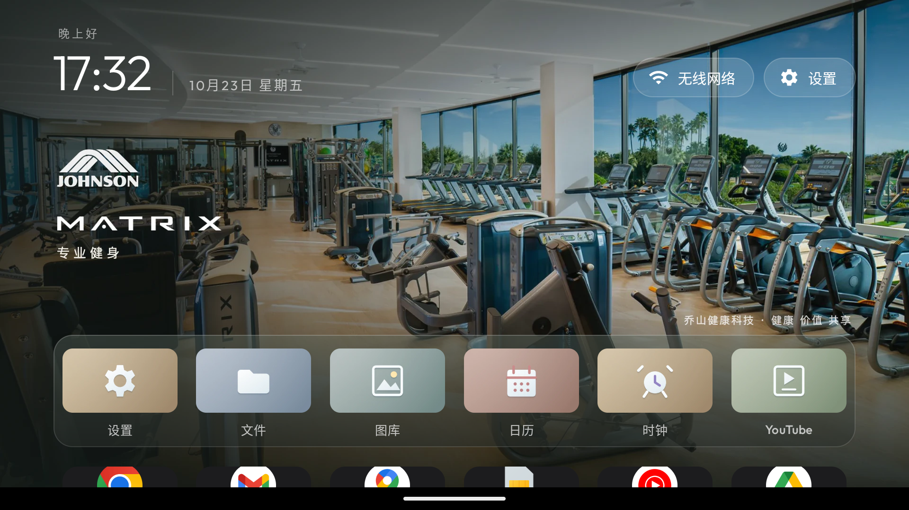

# 乔山主题验收记录

日期：2026-10-23。基于启动器提交 `6afd1ecf8efef95215f406710c73bed1cb973b84`，在独立分支 `dipsy/johnson-health-tech-theme` 制作。

## 交付内容

- `johnson-health-tech`，schema 1，version 2，显示名称「乔山 · 品牌展厅」。
- 七张 1920 × 1080 全屏品牌壁纸、16 张 384 × 216 柔光卡片、一张 960 × 540 主题缩略图；两分钟顺序轮换。
- ZIP：1,017,265 bytes（约 993.4 KiB）。SHA-256：`4cd477bac1115d15cc9fd7387b3cb6561edf802e9f7b3b69f235f32032507ad0`。
- 全部为外置主题资源，未修改启动器代码或向 APK 添加资源。
- 官方照片和标识的 15 项来源记录、原文件大小及哈希均已核对；23 张 WebP 和一张 JPEG 的哈希与导出报告一致，ZIP 的 26 个成员与主题目录逐字节一致。
- 15 张继承卡片的路径、描边和变换与原柔光素材一致；文件卡片使用通用文件夹图形。

## 自动检查

```sh
python3 artwork/johnson-health-tech/build_theme.py
python3 tools/theme_pack.py pack theme-packs/johnson-health-tech backup/johnson-tv-2026-10-23/johnson-health-tech-v2.zip
python3 tools/theme_pack.py inspect backup/johnson-tv-2026-10-23/johnson-health-tech-v2.zip
CLEANYOURTV_STRICT=1 python3 -m unittest discover -s tests -v
git diff --check
```

v1 完整 Python strict 测试 250 项通过（37.137 秒）。真机复核后，v2 仅调整 HORIZON 和 Schwinn 的图片构图及版本，重新生成、打包和检查协议，并运行全部已发布主题包的 4 项测试，均通过。所有 WebP 已完整解码并验证尺寸和不透明性。未修改 Android 源码，因此本次未重新执行 Android 构建和单元测试。

## v1 模拟器检查（历史记录）

使用临时只读 Android 14 手机 AVD，横屏 1920 × 1080、320 dpi、字体缩放 1.0；安装现有 release APK（488,864 bytes）。手机系统手势条和下方应用行的一小部分在截图中可见；该检查不能替代公司电视上的显示、遥控器和性能验收。

- 最终 ZIP 导入并激活成功。七张壁纸从设置页逐一选中并截图，检查品牌标识、产品照片、人物面部与原生时钟、按钮、Dock 的相对位置。
- 六个预览应用为设置、文件、图库、日历、时钟和 YouTube；均使用对应主题卡片。其余未匹配应用使用原生外观。临时 Dock 配置没有写入主题 ZIP。
- ADB 方向键移入 Dock 并聚焦「文件」，确认键启动 `com.google.android.documentsui`，Home 正常返回启动器。
- 将下方行数手动设为 2，切换原版主题再切回乔山，仍为 2。改回 0 后结束并重启启动器进程，仍为 0。
- 自动轮换：激活后不再操作，间隔 179.386 秒的两次截图分别为 MATRIX 和 VISION；确认按顺序自动更换。配置间隔为两分钟，本次没有测量精确切换时刻或完成 14 分钟整轮测试。
- 检查结束时 crash 日志缓冲区为空。



## v1 模拟器录像（历史记录）

七品牌界面操作录像长 132.974522 秒，H.264、1920 × 1080、28,472,306 bytes。录像仅做无损封装和 faststart，未剪辑；原始与封装后时长相同，完整解码通过。视频 SHA-256：`62204b454557c3ddc3f821dccf4af749f093b953817e3d61ab5a8bd8fbcc2d2b`。它展示手动选择七张壁纸，并非完整 14 分钟自动轮播。

本地 `backup/johnson-delivery/` 包含离线预览页、ZIP、七张实际截图、录像及 JSON 检查记录。运行录像不纳入 Git。交付目录同步到 NAS `/volume3/ShareFiles/cleanyourtv-johnson-health-tech-2026-10-23/`，使用 `SHA256SUMS` 核对。

公司电视尚未连接或安装；下面记录的是用户家中小米电视的独立验收。

## 小米电视真机检查（v2）

设备为用户家中的 Xiaomi MiTV-MFTR0，Android 11 / API 30，1920 × 1080。沿用现有 488,864 bytes 的 APK，没有重新安装；验证 APK SHA-256 仍为 `c5470391c998d0add2945073a019c4974617068d703fbbc0d58a56a2212ceb85`。测试通过 ADB 注入方向键、确认键、Home 和设置页点击，不等同于人工操作实体遥控器。

### 真机发现与调整

小米电视顶栏比手机模拟器多了「输入源」按钮。v1 HORIZON 照片中的面部与该按钮重叠，因此 v2 换成 [HORIZON 7.0 AT 官方居家照片](https://www.horizonfitness.com/products/horizon-7-0-at-treadmill)，人物位于时钟与按钮之间；Schwinn 裁切位置小幅左移。两张照片均重新上机验证，七品牌的照片、白色标识和柔光卡片保持同一风格。其余壁纸、预览图、卡片、主题配置及绘制素材中 44 项受保护资源逐字节不变。

### 已验证项目

- 从 ZIP 导入 v1，再升级 v2，电视主题列表返回 `johnson-health-tech` version 2，激活成功。
- 在设置页逐一选中七张壁纸，分别截图和录屏，检查品牌文字、人物与产品、时钟、输入源/无线网络/设置按钮和 Dock 的位置。
- 七张壁纸下 Dock 均保持「无线投屏、云视听小电视、直播电视、Emby、云视听极光、高清播放器」的原有顺序。
- 方向键聚焦 Emby，确认键启动 `com.mb.android/.MainActivity`，Home 正常返回。向下进入应用行，方向键和确认键打开「应用库」，显示 16 个应用。
- 原有 6 列、下方 0 行在导入后保留。手动改为 2 行，切回塞尔达后仍为 2；随后恢复 0 行。v2 结束并重启启动器进程后，仍为 6 列、0 行。
- 设备配置经 provider 导出前后完全一致：671 bytes，SHA-256 `06acb9f4742327566628cd94c6b09908d1eb751cfb5b6f9594d12ec41db0c61c`。默认 HOME 与无障碍服务均未变化。
- 测试期间维持 `screen_brightness=10`、`picture_backlight=5`，按键音临时关闭。

导航与偏好录像在 v1 上录制；v2 只改变两张壁纸与主题版本，随后复验了进程重启后的 6 列 / 0 行及应用库。七品牌录像和截图全部来自 v2。

自动轮播录屏中，激活乔山后保持首页不操作，两张截图相隔 132.491 秒，分别为 MATRIX 和 VISION。确认首次自动切换，不把该采样当作完整 14 分钟循环或性能测量。

结束时恢复塞尔达 v3 与「壁纸：主题默认」，再次确认 6 列、下方 0 行；按键音恢复原值 1，亮度和背光维持原来的 10 / 5。乔山 v2 仍安装在主题列表中。发送休眠键后，电源服务返回 `mWakefulness=Asleep`、`Display Power: state=OFF`。从本次测试开始时间 `10-23 17:50:25.000` 到结束筛选的 crash 日志为空。

结构化检查记录见 [xiaomi-acceptance.json](validation/xiaomi-acceptance.json)。

## 真机录像交付

本地 `backup/johnson-delivery/real-device/` 与 NAS `/volume3/ShareFiles/cleanyourtv-johnson-health-tech-2026-10-23/real-device/` 保存：

| 文件 | 内容 | 时长 |
| --- | --- | ---: |
| `01-brand-scenes-a-v2.mp4` | MATRIX、VISION、HORIZON、BowFlex | 98.264 秒 |
| `02-brand-scenes-b-v2.mp4` | Schwinn、SYNCA、FUJIIRYOKI | 81.049 秒 |
| `03-navigation-and-preferences.mp4` | Emby 启动/返回、焦点移动、跨主题行数保留 | 129.133 秒 |
| `04-auto-rotation.mp4` | 首次 MATRIX → VISION 自动轮播 | 141.336 秒 |

四段均为电视直接录制的 1920 × 1080 H.264，经过无损 faststart 封装并完整解码通过，没有剪辑。轮播录像与实际采集会话长度相差不到 0.1 秒，没有出现尾部伪延长。离线页面同时提供七张品牌截图、两张轮播前后截图、v2 ZIP、验收 JSON、视频校验 JSON 和 SHA256SUMS。旧模拟器材料保留为 v1 历史档案。
