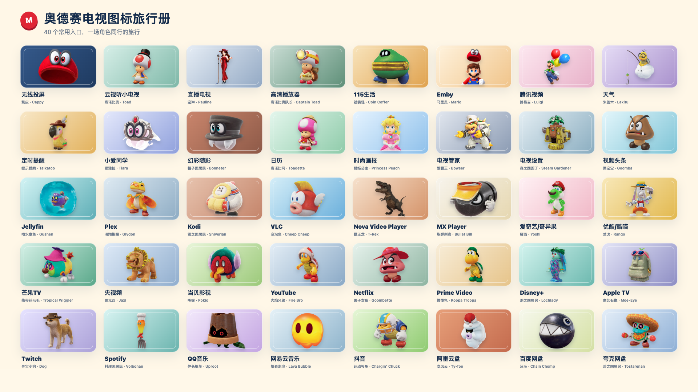

# 奥德赛电视图标旅行册

40个常用应用入口，以《超级马里奥 奥德赛》的角色素材搭配柔和背景。预览会保留应用名，方便从角色主题中辨认入口。



直接打开 `preview.html`。支持应用/角色搜索、分类、横幅/方形、深浅背景、电视小尺寸和方向键导航；点击卡片可以下载横幅或方形图标。

| 内容 | 规格 |
| --- | --- |
| `characters/` | 40张未经重绘或裁切的角色源PNG，原生尺寸见sources.json |
| `banners/` | 40张640×360透明圆角横幅PNG，不含应用文字 |
| `squares/` | 40张512×512透明圆角方形PNG，不含应用文字 |
| `android/res/drawable-nodpi/` | 80个可直接打包的Android位图资源 |
| `launcher/` | 40张768×432满版不透明横幅母版，桌面APK的WebP由此导出；本地生成、不入库，用 `npm run launcher` 重建 |
| `theme-overlay.json` | 16个已有包名的横幅映射；保持显示应用名称 |
| `manifest.json` | 40个应用、角色、背景色和对应关系 |
| `sources.json` | 每张原图的来源、原生尺寸与SHA-256 |

Emby对应Mario，投屏对应Cappy，云视听小电视对应Toad，直播电视对应Pauline。固定栏预览仍按“投屏 → 小电视 → 直播 → Emby”排列。

## 复现

Python脚本只使用标准库。预览图导出需要Node.js及package.json声明的Playwright。

```sh
python3 make_preview.py
npm install
npx playwright install chromium
npm run render
python3 build_resources.py
```

已有Chrome时，可指定 `CHROME_PATH` 后运行导出脚本。导出过程渲染预览中的卡片，不修改characters目录中的角色原图。

### 桌面横幅（WebP）

桌面APK内置的横幅单独导出，不使用上面的640×360 PNG。需要libwebp的 `cwebp`/`dwebp`（如 `brew install webp`）。

```sh
PLAYWRIGHT_SKIP_BROWSER_DOWNLOAD=1 npm install --no-package-lock
CHROME_PATH='/Applications/Google Chrome.app/Contents/MacOS/Google Chrome' npm run launcher
```

`render_launcher.mjs` 载入preview.html并注入样式，按320×180卡片的2.4倍渲染 `launcher/<id>.png`（768×432）；`build_launcher.py` 再用 `cwebp -resize 384 216 -q 88 -sharp_yuv -m 6 -noalpha` 编码为 `banner_odyssey_<id>.webp`，写入 `launcher/app/src/main/res/drawable-nodpi/`，替换同名PNG，并生成 `validation/launcher-report.json`（每张的尺寸、字节数、SHA-256与不透明检查）。也可传入其他输出目录先行检查。

这一版有意与预览不同：满版不透明，去掉透明圆角、外描边、内框和卡片阴影，圆角与边框交给桌面磁贴；角色放大约15%（`characterScale` 1.15），从底边向上放大，半身角色贴齐底边、全身角色上方留出少许空间。背景渐变与角色的水平位置不变，preview.html与banners/、squares/、android/的导出不受影响。

## 接入桌面

其他桌面工程：把android/res中的资源合并进去后重新构建，再合并theme-overlay.json中的应用横幅映射。本仓库的launcher已内置`npm run launcher`导出的同名WebP横幅，不要再复制banner_odyssey_*.png进去，否则构建会报Duplicate resources，只需合并横幅映射。只导入JSON不能为现有APK增加图片资源。24个没有核实包名的应用保留空值，安装对应应用后再按实际包名填写。

Android资源使用导出的640×360/512×512图片，避免加载数千像素原画。源素材分辨率不一，放大导出不会增加原图细节，优先按电视图标尺寸使用。桌面工程本身改用上节的384×216 WebP：磁贴约243×136（六列）至342×192（四列聚焦），缩放更小、解码内存约为PNG的三分之一。

2026-10-22 已安装到小米 MiTV-MFTR0 / freeguy。桌面工程内置 40 张横幅，启用 16 个已核实应用映射；方形图标与角色原图保留在设计包中，不进入桌面 APK。内置默认配置和 [Odyssey 预设](../../themes/xiaomi-freeguy-odyssey/config.json)保持原固定栏顺序，覆盖更新保留应用数据。部署与恢复说明见[设备记录](../../docs/devices/xiaomi-mitv-mftr0-freeguy-android11.md)。

角色素材与来源见[SOURCES.md](SOURCES.md)，美术权利说明见[LICENSE-ASSETS.md](LICENSE-ASSETS.md)。
