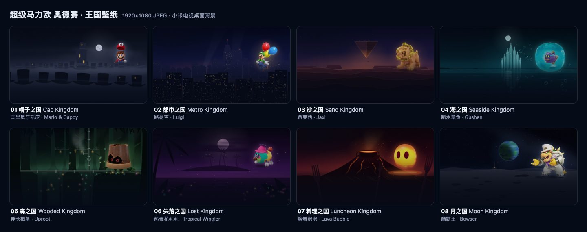

# 奥德赛王国电视壁纸

8张1920×1080桌面背景。每张按《超级马里奥 奥德赛》一个王国的配色和地标用代码绘制，再配一位角色原画。[Odyssey 预设](../../themes/xiaomi-freeguy-odyssey/config.json)在桌面停留时每分钟按文件名顺序换一张，新图约1.2秒淡入。



| 编号 | 王国 | 角色 | 画面 |
| --- | --- | --- | --- |
| 01 | 帽子之国 / Cap Kingdom | 马里奥与凯皮 / Mario & Cappy | 雾中石板灰夜色，礼帽形状的房屋与高塔 |
| 02 | 都市之国 / Metro Kingdom | 路易吉 / Luigi | 新唐克市夜景，路易吉拉着气球飘过摩天楼窗灯 |
| 03 | 沙之国 / Sand Kingdom | 贾克西 / Jaxi | 沙漠黄昏余晖，倒立金字塔悬在夜空 |
| 04 | 海之国 / Seaside Kingdom | 喷水章鱼 / Gushen | 深青色夜海，玻璃尖塔与上升的气泡 |
| 05 | 森之国 / Wooded Kingdom | 伸长根茎 / Uproot | 蒸汽花园的暗林，铁管、蒸汽与发光花朵 |
| 06 | 失落之国 / Lost Kingdom | 热带花毛毛 / Tropical Wiggler | 紫色热带夜，棕榈叶影、毒沼微光与萤火 |
| 07 | 料理之国 / Luncheon Kingdom | 熔岩泡泡 / Lava Bubble | 沃尔波诺火山的酒红夜色，熔岩、大汤锅与巨型餐叉 |
| 08 | 月之国 / Moon Kingdom | 酷霸王 / Bowser | 月面陨坑与教堂剪影，远方蓝色星球的光晕 |

| 内容 | 说明 |
| --- | --- |
| `scenes.json` | 每张壁纸的编号、中英文标题、角色位置/高度/脸部比例/翻转、配色和母题参数，以及共用的角色区域、压暗、颗粒和界面参考框 |
| `make_wallpapers.py` | 只用Python标准库，从scenes.json生成wallpapers.html |
| `wallpapers.html` | 每张壁纸一个1920×1080的section，背景是SVG，角色引用`../mario-odyssey-icons/characters/`中的原图 |
| `render_wallpapers.mjs` | 用Playwright把每个section截成JPEG（质量85），写入主题的`wallpapers/`，再生成校验报告和缩略图 |
| `validation/wallpapers-report.json` | 每张图的尺寸、字节数、SHA-256，角色的位置和脸部下沿，以及时钟区、底部45%区和标题区的平均亮度 |
| `contact-sheet.jpg` | 8张壁纸的缩略图 |

## 版式

桌面的时钟、按钮、应用标题和固定栏都叠在壁纸上，所以画面要给界面让位：

- 角色只放在右侧约40%（x≥1120）。右上角按钮的下沿约在y 201，角色顶边y≥225，和按钮隔开24像素。
- 固定栏的色带几乎不透明（90%–94%），盖住的部分基本看不见。默认六列时色带上沿约在y 532；在电视上改成四列后，下面一行变大，色带上移到约y 486。每个角色在scenes.json里记了`face`，即脸部下沿（下巴、下颌或最低的眼睛）占角色高度的比例；脚本要求脸部下沿y≤472，四列时也不会被盖住。身体可以延伸到固定栏后面。
- 在电视上把下方行数改成2或3行时，固定栏会升到约y 440，这时除熔岩泡泡外，其余角色的脸部下缘会被盖住约30像素；要完全让开就得把角色缩得太小，所以只保证默认的一行。
- 左上角的时钟和问候、左侧应用标题一带不放主体；地标放在画面中部（x≥750）。
- 画面从高度48%处开始向下压暗，到底边约为86%的深海军蓝 #060B18；左上角时钟后面另有一片柔和压暗，顶边也轻压一层，衬托按钮。
- 叠加约1.5%的单色颗粒（SVG feTurbulence，固定种子）。桌面默认以RGB_565解码壁纸，颗粒能减轻暗部渐变的色带。
- 角色只缩小、不放大。生成前，脚本按`../mario-odyssey-icons/sources.json`核对每张原图的尺寸和SHA-256；角色高度不超过原图，也不超过756px（画面高度的70%）。

打开`wallpapers.html#guides`，可以看到时钟、按钮、应用标题、固定栏和下方一行的大致位置，四列时固定栏上移的范围，以及每个角色的脸部下沿（黄线）。这些位置按1080p、密度2（与[小米电视截图](../../docs/devices/xiaomi-mitv-aetp0-home.png)一致）和默认的六列、下方一行，从`MainActivity`、`AppAdapter`和`DockDecoration`的尺寸推算，实机位置以电视为准。

## 复现

Python脚本只使用标准库。导出时使用本机安装的Chrome，不下载Playwright自带的浏览器。

```sh
python3 -I make_wallpapers.py
PLAYWRIGHT_SKIP_BROWSER_DOWNLOAD=1 npm install --no-package-lock
npm run render    # 写入 ../../themes/xiaomi-freeguy-odyssey/wallpapers/*.jpg、校验报告和contact-sheet.jpg
npm run verify    # 不重新渲染，只校验现有JPEG并更新报告
```

Chrome不在`/Applications/Google Chrome.app`时，用`CHROME_PATH`指定路径。校验要求每张图为1920×1080、120–320 KiB，时钟区（左上640×260）平均亮度低于0.35，底部45%低于0.30，标题区低于0.35；任何一项不满足，脚本都会以失败退出。亮度取解码后JPEG的sRGB亮度（0.2126 R + 0.7152 G + 0.0722 B），0为黑，1为白。

固定种子保证同一份scenes.json生成的HTML逐字节一致；用同一版本的Chrome重复渲染，JPEG也逐字节一致。JPEG由Chrome渲染和编码，换Chrome版本后，画面不变，但SHA-256可能不同；报告里记录了生成时的Chrome版本。

## 接入主题

Odyssey预设打开了壁纸：`wallpaper_rotation_minutes`为1，`wallpaper_order`为`sequential`。`wallpaper_names`按文件名给8张图配上王国名（与scenes.json的中文标题一致），预设的`header_style`为`odyssey`，问候语前会显示当前壁纸的王国，如「帽子之国 · 下午好」，换图时随之更新。压暗已经画进图里，`wallpaper_dim`只设为8，加一层很轻的遮罩。`background_color`为#060B18，在第一张图解码前显示。用`tools/theme.sh`推送`themes/xiaomi-freeguy-odyssey`，具体的推送方式和包名见[设备记录](../../docs/devices/xiaomi-mitv-mftr0-freeguy-android11.md)。在电视的「简洁桌面设置 → 壁纸」里，可以固定其中一张，或选择「无」。

换图的确切规则：距上次换图满1分钟才换下一张，而且只在桌面位于前台时检查——回到桌面时检查一次，之后每分钟检查一次，所以一直停在桌面上就每分钟换一张。打开应用或小米屏保盖住桌面时不换图，也不补换；隔了很久再回到桌面，只前进一张。新图在1.2秒内淡入到旧图上（先快后慢），淡入一半时（约0.35秒）王国名和金币一起切换，固定栏托盘的色调随同一过渡渐变；淡入结束后只保留新图一张位图。打开桌面时的第一张图、在电视上固定某一张，以及关闭动态效果或打开`reduced_motion`时，都直接切换，不淡入。

`wallpaper_coins`把时钟前的金币换成当前王国的紫色本地硬币（`coin_odyssey_*`，见[王国金币](../mario-odyssey-coins/README.md)），`wallpaper_tints`给固定栏托盘换上与王国同色调的半透明底色（如帽子之国#454C87），两者都随换图更新；没有对应条目、选了「无」或只有纯色背景时，退回金色矢量金币和原来的深色托盘。都市之国的硬币是Pauline侧像，与都市壁纸换掉Pauline一致，预设写的是`02-metro.jpg=ic_odyssey_coin`，显示金色矢量金币；改回`coin_odyssey_metro`即可换成都市硬币。

## 授权

角色素材来自同级的[奥德赛图标旅行册](../mario-odyssey-icons/)，来源逐项列在它的SOURCES.md和sources.json里。本目录没有新增或修改任何角色原图。《超级马里奥 奥德赛》的角色与美术权利归Nintendo及相应权利人，详见[LICENSE-ASSETS.md](../mario-odyssey-icons/LICENSE-ASSETS.md)。这组壁纸只供个人电视主题使用，不是Nintendo官方作品。背景绘制代码和生成脚本沿用项目代码许可。
