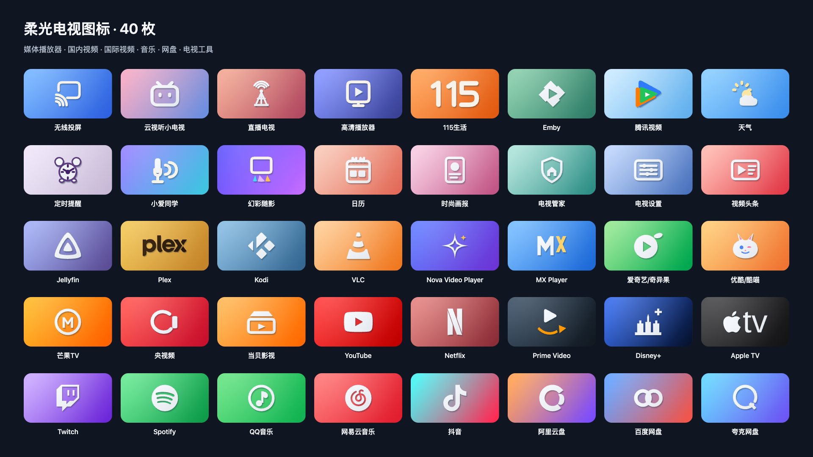

# 柔光电视图标

40 枚适用于电视桌面的图标，覆盖现有电视入口、常用媒体播放器、国内外视频平台、音乐和网盘。统一使用柔和渐变、左上柔光与轻微凸起的轮廓。



打开 [preview.html](preview.html) 可离线预览，支持应用搜索、横幅/方形切换、深浅背景、小尺寸和键盘操作。

## 文件

| 文件 | 用途 |
| --- | --- |
| `svg/` | 40 个 320×180 横幅 SVG，源图满幅，圆角由桌面裁切 |
| `square/` | 40 个 256×256 方形 SVG，带圆角透明边缘 |
| `android/` | 40 个对应的 Android VectorDrawable；180×101.25dp，视口 320×180 |
| `design-data.json` | 图案、品牌参考、颜色与目标尺寸 |
| `geometry-bounds.json` | 图案几何边界，用于等比缩放和居中 |
| `manifest.json` | 图标路径、类别、搜索别名、已确认的包名 |
| `theme-overlay.json` | 现有 16 个电视入口的映射示例 |
| `render_pack.py` / `make_preview.py` | 无网络、仅 Python 标准库的再生成工具 |
| `ACCEPTANCE.md` | 验收范围、结果与适用边界 |

完整下载包另含 `png/` 的 640×360 横幅与 `png-square/` 的 512×512 方形，共 80 张 PNG。

## 再生成

在本目录执行：

```sh
python3 validate.py design-data.json
python3 render_pack.py
python3 make_preview.py
```

更改路径几何时，需要同步更新 `geometry-bounds.json`；仅调整配色不需要更改边界。

## 与电视桌面的关系

本目录是可预览、可集成的图标套件。当前电视使用的主题仍以设备记录为准，本套件尚未安装到电视。

`theme-overlay.json` 中的 `banner_studio_*` 需要先把对应 Android 资源合入桌面安装包，才可以应用。它仅包含当前已确认的 16 个应用包名；其他 24 枚素材待安装对应应用、确认包名后再添加映射。图标包不会安装这些应用，也不改变现有 Emby 登录或 NAS 设置。

参考轮廓与风格化重绘分别记录在 `manifest.json` 的 `brand_reference`、`stylized` 字段中；来源见 [SOURCES.md](SOURCES.md)。
