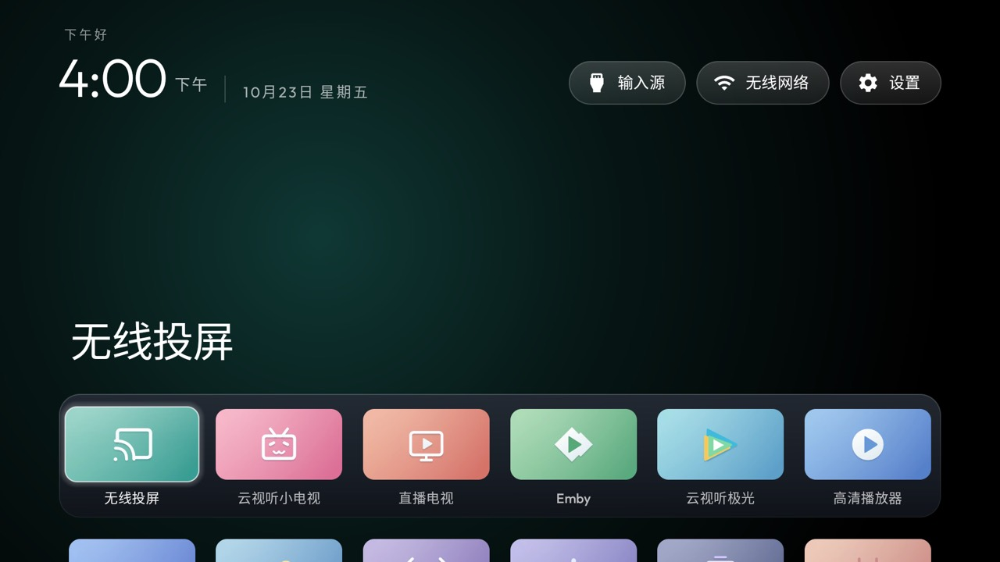
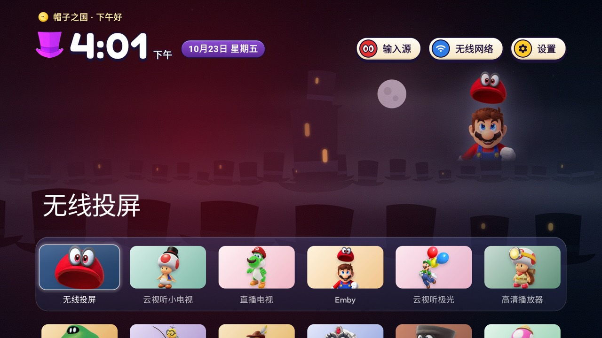
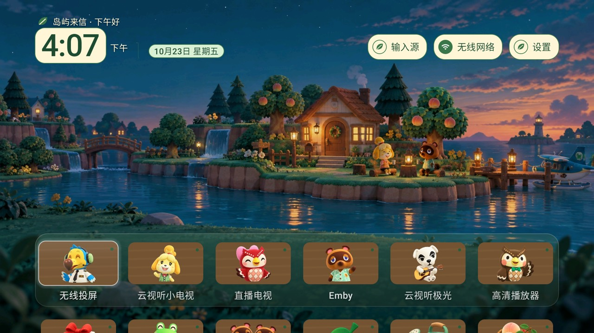
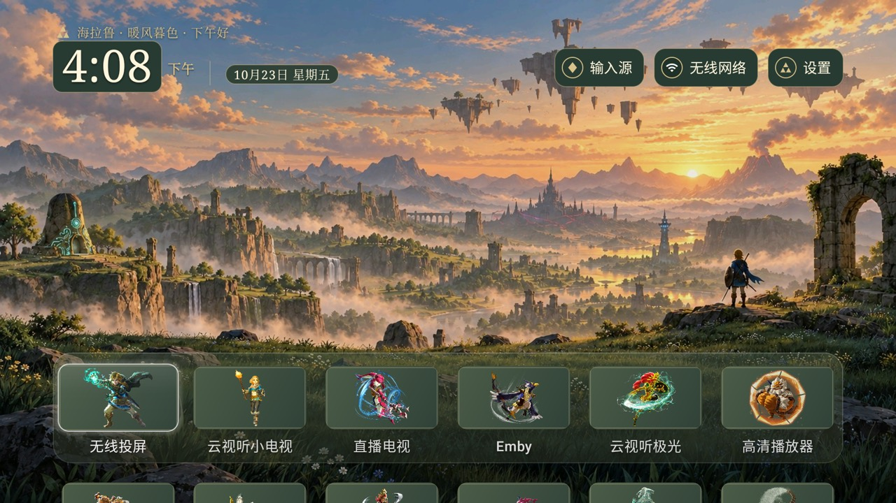

# Personal theme gallery

This fork provides four offline theme packs for the launcher: **Soft Glow v1**,
**Mario Odyssey v1**, **Animal Crossing v2**, and **Zelda v3**. Each pack is a
ZIP that can be imported on the TV and selected in the launcher’s theme picker.
The packs contain only theme resources and configuration. The launcher has no
Internet permission, analytics, or theme downloads; imported packs work offline.

Install the APK built from this fork before importing a ZIP. The upstream stock
APK does not support these fork-specific packs. The public build and import
commands are in the [theme-pack guide](../theme-packs/README.md), together with
the pack format and the existing artwork credits.

## On-TV gallery

| Theme | Screenshot |
| --- | --- |
| Soft Glow v1 |  |
| Mario Odyssey v1 |  |
| Animal Crossing v2 |  |
| Zelda v3 |  |

These four screenshots were captured on a Xiaomi MiTV-MFTR0 running Android 11
on 2026-10-23. The six-column layout and zero rows below the Dock shown here
are device-side manual preferences, not defaults guaranteed by every theme.

Theme switching preserves the app order and manual preferences. The theme-pack
guide describes the offline ZIP import flow, on-TV switching, and the cases
where a user explicitly chooses to follow a theme’s defaults.

## Evidence and limits

At commit `6afd1ec`, the Android build test suite reported 250 passing tests
and the strict Python suite reported 250 passing tests. On the TV, switching
between all four packs preserved the saved six columns and zero rows below the
Dock. A separate two-row preference survived a theme switch, and the final
Zelda selection and layout survived a launcher process restart. Odyssey's
wallpaper, kingdom name, coin, and Dock tint rotated together.

The on-device checks
used ADB-injected navigation, confirmation, Back, and Home actions. They did
not claim physical-remote testing, a cold boot, or a full power-cycle test. See
the repository’s [theme-pack guide](../theme-packs/README.md) for reproducible
public build and import commands.
